# سامانه تفکیک و رهگیری مرسولات پستی

این repository پیاده‌سازی Phase 1 یک سامانه‌ی دو‌بخشی **Edge + Core** برای دریافت خوانش مرسوله، تعیین مقصد، بستن کیسه و بستن دیسپچ در مرکز مبادله است. تصمیم محوری این معماری آن است که عملیات خط تفکیک، حتی در قطع موقت Core، در Edge ادامه پیدا کند؛ داده‌های پذیرفته‌شده به‌صورت پایدار ثبت و سپس با قراردادهای نسخه‌دار و idempotent به Core همگام می‌شوند.

> این سند «وضعیت همین کد» را توصیف می‌کند. هر چیزی که به ورودی سازمانی یا زیرساخت بیرونی نیاز دارد با برچسب **Blocked** یا **Conditional** مشخص شده است و نباید آماده‌ی Production فرض شود.

## مسئله‌ی کسب‌وکار

دستگاه تفکیک باید با کمترین وابستگی به شبکه‌ی مرکز:

1. با `deviceId` و `deviceToken` در Edge احراز هویت شود؛
2. یک یا چند بارکد و ویژگی فیزیکی را به‌عنوان خوانش ورودی ثبت کند؛
3. مقصد و chute را تأیید کند؛
4. مرسوله‌های واجد شرایط را در کیسه ببندد و نتیجه/لیبل را دریافت کند؛
5. کیسه‌های ساخته‌شده توسط همان دستگاه را در یک دیسپچ ببندد؛
6. رخدادها، سلامت، خروجی عملیاتی و metadata تصویر را بدون تکرار اثر به Core برساند.

سامانه‌ی پستی بالادست مرجع رسمی عملیات پستی است. Edge مرجع اجرای محلی و تداوم سرویس، و Core مرجع داخلی تاریخچه، پیکربندی، مشاهده‌پذیری و گزارش‌گیری است. این تفکیک مانع از آن می‌شود که یک cache یا projection به‌اشتباه مرجع قانونی داده تلقی شود.

## دامنه‌ی Phase 1

| قابلیت | وضعیت repository | توضیح |
| --- | --- | --- |
| قرارداد Device ↔ Edge V1 | Implemented | envelope نسخه‌دار، `correlationId` و `operationId` اختیاری و پایدار |
| جریان inbound / destination / bag / dispatch در Edge | Implemented | لایه‌های Domain، Application و Infrastructure با SQLite |
| SignalR device gateway | Implemented | مسیر و روش‌ها در [پروتکل دستگاه](docs/api/device-protocol.md)؛ mapping wire از مدل داخلی جدا است |
| حالت Mock | Implemented | اجرای local بدون credential سازمانی |
| حالت Connected | Conditional | adapterها موجودند؛ صحت نهایی به SQL schema/SP و SOAP WSDL رسمی وابسته است |
| SQLite WAL، operation journal و outbox | Implemented | retry محدود، lock، dead-letter و worker پس‌زمینه |
| Core bounded services و Gateway | Implemented/hosted per API map | پنج DbContext مستقل، YARP، JWT و policyهای Edge/Admin |
| provisioning/rotation credential ارتباط Edge → Core | Implemented | Admin scoped secret را فقط در پاسخ اول می‌گیرد؛ Core فقط verifier، receipt بدون secret، audit و outbox را نگه می‌دارد |
| S3-compatible pre-signing | Implemented adapter | نیازمند endpoint/bucket/credential بیرونی |
| Idempotency مشترک | SQL authoritative + Redis mirror | `IdempotencyRecord`/Inbox و unique constraint مرجع‌اند؛ Redis فعال اما قابل بازسازی و غیرمرجع است (ADR-0008) |
| Kafka-compatible durable publisher | Implemented; runtime conditional | producer واقعی Confluent با idempotence/`acks=all`؛ نیازمند broker و topicهای عملیاتی |
| UI مدیریتی و گزارش‌گیری تحلیلی | خارج از Phase 1 | مدل و queryهای پایه وجود دارد؛ UI تحویل نشده است |
| Docker Compose | Mock + full-development | full overlay: auth-on، پنج SQL DB، Redis، Redpanda، MinIO/SSE، TDE، observability و HA gate؛ Production نیست |
| Kubernetes manifests | Not shipped | design notes در [deploy.md](deploy.md) آمده است |

## معماری در یک نگاه



جزئیات مرزها، dependency ruleها و تصمیم‌ها در [Architecture Overview](docs/architecture/overview.md) و ADRها ثبت شده است.

- **Device plane:** ارتباط realtime و نسخه‌دار با Edge؛ هیچ دستگاهی مستقیم به Core یا دیتابیس سازمانی وصل نمی‌شود.
- **Edge operational plane:** یک process در هر مرکز، SQLite در WAL mode، اجرای use caseها، journal، outbox، pending work و adapterهای بالادست.
- **Core control/data plane:** API Gateway و سرویس‌های هویت، ingestion، چرخه‌ی مرسوله، پیکربندی، object storage، سلامت Edge و نتیجه‌ی عملیاتی.
- **External systems:** API مقصد، SQL عملیاتی پست، SOAP اطلاعات مرسوله، SQL Server، object storage و message broker.

### قواعد وابستگی

```text
Domain -> Shared contracts only
Application -> Domain + Shared contracts/building blocks
Infrastructure -> Application ports + Domain + Shared
API host -> Application + Infrastructure + ApiSupport
Gateway -> BuildingBlocks + YARP/authentication
Tests -> project under test
```

Domainها به EF Core، HTTP، SignalR، SQL و framework hosting وابسته نیستند. adapterهای بیرونی پشت portهای Application قرار دارند. هر تغییر در payload عمومی ابتدا باید در `Post.Contracts` نسخه‌گذاری و با compatibility test پوشش داده شود.

## نقشه‌ی solution

| مسیر | مسئولیت |
| --- | --- |
| `src/Shared/Post.Contracts` | قراردادهای wire نسخه‌دار Device ↔ Edge و Edge ↔ Core |
| `src/Shared/Post.BuildingBlocks` | Result/Error، guard، clock، correlation، idempotency، outbox، pagination، redaction و JSON defaults |
| `src/Shared/Post.ApiSupport` | host defaults، Problem Details، health، Swagger، JWT و authorization policy |
| `src/Edge/Post.Edge.Domain` | aggregateها و value objectهای مرسوله، کیسه، دیسپچ و دستگاه |
| `src/Edge/Post.Edge.Application` | use caseها و portهای persistence/integration |
| `src/Edge/Post.Edge.Infrastructure` | SQLite/EF Core، migration، workerها و adapterهای Mock/Connected |
| `src/Edge/Post.Edge.Api` | composition root و SignalR boundary دستگاه |
| `src/Core/Post.Core.Domain` | مدل چرخه‌ی مرسوله، دستگاه، سلامت، هویت و reliability |
| `src/Core/Post.Core.Application` | سرویس‌های کاربردی و contractهای داخلی Core |
| `src/Core/Post.Core.Infrastructure` | پنج DbContext، storeها، JWT، S3 و publisher adapterها |
| `src/Core/Post.Core.ApiSupport` | composition مشترک profile-aware، initialization، access scope و database readiness برای Core hostها |
| `src/Core/Post.Core.*.Api` | hostهای bounded service؛ مسیرها در [Core API](docs/api/core-api.md) |
| `src/Core/Post.Core.Gateway` | YARP reverse proxy، bearer validation و rate limiting |
| `tools/Post.DeviceSimulator` | client توسعه‌ای برای اجرای سناریوهای device protocol |
| `tests/*` | unit، contract، architecture، infrastructure و API integration tests |
| `scripts/*` | build/test evidence، publish، diagram verification و secret hygiene |

## شروع سریع

### پیش‌نیازها

- .NET SDK مطابق `global.json`؛ در این revision نسخه‌ی pin‌شده `10.0.400` است.
- PowerShell 7 برای scriptهای repository.
- Node.js/npm فقط برای markdownlint نسخه‌پین‌شده‌ی gate مستندات.
- فضای نوشتن local برای SQLite و `artifacts/`.
- برای حالت Connected: دسترسی مجاز شبکه و secretهای تزریق‌شده از بیرون repository.

```powershell
dotnet --version
dotnet restore .\Post.sln
dotnet build .\Post.sln -c Release
```

### اجرای Mock

Mock برای توسعه و تست پذیرش بدون SQL/SOAP/API واقعی است. token نمونه را فقط در process محیط توسعه تزریق کنید.

fallback انتخاب‌گر در غیاب configuration، `LocalConnected` است؛ اما `appsettings.json` متعهد و Compose برای safety local مقدار `Mock` را صریح می‌گذارند. هر environment باید profile خود را صریح نگه دارد تا حذف سهوی key به Destination واقعی منجر نشود.

```powershell
$env:ASPNETCORE_ENVIRONMENT = 'Development'
$env:Edge__Integrations__Profile = 'Mock'
$env:Edge__Storage__ConnectionString = 'Data Source=.\artifacts\local\edge.db'
$env:Edge__Mock__Devices__0__DeviceId = 'local-device'
$env:Edge__Mock__Devices__0__LogicalId = 'LOCAL-01'
$env:Edge__Mock__Devices__0__Token = 'set-a-local-non-production-token'
$env:Edge__Security__AllowUnboundDevices = 'true' # فقط local Mock
$env:Edge__LocalAdmin__AuthenticationEnabled = 'false' # فقط smoke loopback
dotnet run --project .\src\Edge\Post.Edge.Api
```

سپس liveness و readiness را بررسی کنید و client را به `/ws/device` متصل کنید. payloadهای دقیق و سناریوهای منفی در [docs/TESTING.md](docs/TESTING.md) آمده‌اند.

اجرای یک‌فرمانی همان Mock با Docker Compose:

```powershell
docker compose -p post-platform-mock -f compose.yaml config --quiet
docker compose -p post-platform-mock -f compose.yaml up --detach --build
Invoke-RestMethod http://127.0.0.1:7088/health
Invoke-RestMethod http://127.0.0.1:7080/health
```

این profile احراز هویت را خاموش و از fixture مصنوعی استفاده می‌کند؛ فقط روی workstation توسعه است. `docker compose -p post-platform-mock -f compose.yaml down` داده‌ی volumeها را نگه می‌دارد.

برای E2E واقعی Core با SQL Server/Redis/Kafka/S3، credentialهای کاملاً synthetic
و auth فعال، runner full-development را اجرا کنید:

```powershell
.\scripts\infra\test-full-dev.ps1 -ResetData -IncludeObservability -IncludeHa
```

این runner project خود را scope می‌کند، dependencyها را با health gate بالا
می‌آورد، Edge را امن provision و device simulator/Kafka/S3/Redis/TDE/HA/load و
observability را واقعاً بررسی می‌کند و به‌طور پیش‌فرض containerها را بدون حذف
volume پایین می‌آورد. شرح switchها و محدودیت‌های مجوز/Production در
[deploy.md](deploy.md) است.

برای smoke همهٔ artifactهای publish‌شده بدون container:

```powershell
.\scripts\publish-local.ps1 -Configuration Release
.\scripts\start-published-local.ps1 -EdgeProfile Mock
Invoke-RestMethod http://127.0.0.1:7088/health/ready
Invoke-RestMethod http://127.0.0.1:7080/health/ready
.\scripts\stop-published-local.ps1
```

این runner نه host را loopback-only با auth-off Development بالا می‌آورد، یک identity مصنوعی صریح (`EdgeId=3333…`, center `12345`, نقش Edge/CenterAdministrator) تزریق می‌کند و database/log را در `artifacts/local-runtime/` نگه می‌دارد. این identity فقط وقتی auth خاموش و environment برابر Development/Testing است فعال می‌شود؛ جزئیات profile `LocalConnected`، readiness، PID validation و cleanup در [deploy.md](deploy.md) آمده است.

### اجرای Connected

profile **Connected** تمام adapterهای Destination، Postal و Core را Real می‌کند و در startup configuration ناقص یا endpoint غیر-HTTPS را رد می‌کند:

```powershell
$env:ASPNETCORE_ENVIRONMENT = 'Development'
$env:Edge__Integrations__Profile = 'Connected'
$env:Edge__CoreApi__BaseAddress = 'https://core.example.invalid'
dotnet run --project .\src\Edge\Post.Edge.Api
```

این command به‌تنهایی کافی نیست. `Edge:DestinationApi`، `Edge:PostalSql`، `Edge:PostalSoap` و bearer مربوط به Core باید از user-secrets، secret manager یا environment امن فراهم شوند. `LocalConnected` فقط Destination واقعی و Postal/Core mock است؛ `Custom` نیز `Destination`, `Postal` و `Core` را جداگانه روی Mock/Real می‌گذارد. روش بدون ثبت secret در history در [راهنمای تست](docs/TESTING.md) توضیح داده شده است. تا دریافت SQL connection/schema، SOAP WSDL و ruleهای رسمی، Connected فقط یک integration candidate است.

### اجرای Core در local

Gateway به‌صورت پیش‌فرض backendها را روی portهای `7101` تا `7107` می‌جوید. هر host را در terminal جداگانه با URL متناظر اجرا کنید، سپس Gateway را بالا بیاورید. برای Development فقط در یک workstation ایزوله می‌توان authentication را موقتاً غیرفعال کرد؛ این تنظیم در Production fail-fast می‌شود.

```powershell
$env:ASPNETCORE_ENVIRONMENT = 'Development'
$env:Api__AuthenticationEnabled = 'false'
$env:Auth__AuthenticationEnabled = 'false'
dotnet run --project .\src\Core\Post.Core.Gateway
```

راه‌اندازی کامل databaseها و dependencyهای Core در [deploy.md](deploy.md) آمده است.

## نقشه‌ی API

| سطح | مسیر/قرارداد | مرجع |
| --- | --- | --- |
| Device realtime | `/ws/device`؛ `Auth`, `RegisterInbound`, `AssignDestination`, `CloseBag`, `CloseDispatch` | [Device protocol](docs/api/device-protocol.md) |
| Edge admin | `/admin/devices/{id}/ip`، `/api/edge/status` و health | [Device protocol](docs/api/device-protocol.md) |
| Core Gateway | `/api/auth/*`, `/api/edge/*`, `/api/admin/*` | [Core API](docs/api/core-api.md) |
| Service health | `/health/live`, `/health/ready`, `/health` | [Runbook](docs/operations/runbook.md) |
| Gateway health | `/health`, `/health/ready` | [Runbook](docs/operations/runbook.md) |
| Prometheus metrics | `/metrics` | [Runbook](docs/operations/runbook.md) |
| OpenAPI | `/swagger` در non-production یا با opt-in | [Core API](docs/api/core-api.md) |

تمام عملیات اثرگذار باید `operationId` یا idempotency key پایدار داشته باشند. `correlationId` برای trace یک تلاش است و می‌تواند در retry عوض شود؛ استفاده از آن به‌عنوان کلید پایدار فقط fallback سازگاری است و تضمین exactly-once نمی‌دهد.

## امنیت

- secret واقعی، connection string، token، pre-signed URL و محتوای credential نباید commit یا log شود.
- username/password بخش `Edge:DestinationApi` فقط credential نام‌کاربری/گذرواژهٔ OAuth سرویس جست‌وجوی مقصد Iran Post است؛ adapter آن را با `grant_type=password` برای تبدیل بارکد ۱۴ رقمی به `ToCityID` مصرف می‌کند. این secret با OAuth Client Credentials grant، device token، Core JWT، SQL و SOAP credential تفاوت دارد و access token فقط در حافظه cache می‌شود.
- چون آرشیو ورودی credential مقصد را به‌صورت plaintext در معرض قرار داده بود، مقدار آن باید پس از validation rotate شود؛ هیچ مقدار آن در این repository بازنشر نشده است.
- Device token در snapshotهای عمومی به‌صورت hash نسخه‌دار نگهداری می‌شود؛ raw token فقط در boundary احراز هویت و حافظه‌ی کوتاه‌عمر حضور دارد.
- IP binding محلی Edge مستقل از config sync است؛ دستگاه unbound به‌طور پیش‌فرض رد می‌شود و bypass فقط برای Development/Mock باید صریح فعال شود.
- مسیر شبکه‌ی Device → Edge باید مستقیم/source-preserving باشد؛ NAT یا proxy/LB تغییر‌دهنده‌ی IP مبدأ پشتیبانی نمی‌شود و Edge عمداً هدر forwarded را منبع هویت نمی‌گیرد.
- Core Gateway و API hostها JWT را با issuer، audience، lifetime و signing key حداقل ۳۲ بایت اعتبارسنجی می‌کنند.
- policyهای `Edge` و `Administrator` مرز machine-to-machine و عملیات مدیریتی را جدا می‌کنند.
- `POST /api/admin/edges`، `POST /api/admin/edges/{deviceId}/rotate-secret` و `POST /api/admin/edges/{deviceId}/disable` فقط برای Administrator در scope مرکز مجاز و idempotent هستند. دو عملیات اول secret خام Edge را فقط در پاسخ اول برمی‌گردانند و replay مقدار را افشا نمی‌کند. operator باید همان لحظه مقدار را به secret store مقصد منتقل و response/capture را پاک کند. در فقدان یا افشا، با key جدید rotate کنید؛ disable با key مستقل برای containment فوری است.
- `POST /api/admin/devices/{deviceId}/rotate-secret` همین قاعدهٔ one-time response را برای token دستگاه sorting دارد و verifier آن را با snapshot version جدید منتشر می‌کند.
- endpointهای مدیریتی خود Edge از local-admin store، verifier PBKDF2، session محدود و rate limit مستقل از Core JWT استفاده می‌کنند؛ bootstrap تولیدی فقط از secret source و به‌صورت fail-closed مجاز است.
- TLS termination، network policy، least privilege DB user و secret rotation برای Production اجباری‌اند.
- پاسخ‌های خطا Problem Details و پیام‌های امن دارند؛ redaction utility برای نام‌های حساس موجود است.
- `scripts/verify-no-secrets.ps1` در CI اجرا می‌شود؛ این ابزار جایگزین secret scanner سازمانی و history scan نیست.

راهنمای threat/reliability در [Reliability and Security](docs/architecture/reliability-security.md) و رویه‌ی incident در [Runbook](docs/operations/runbook.md) است.

## مشاهده‌پذیری

- `X-Correlation-ID` در HTTP پذیرفته یا تولید و در پاسخ بازگردانده می‌شود.
- envelopeهای device و Edge ↔ Core correlation و timestamp دارند.
- health endpointها liveness و readiness را جدا می‌کنند.
- API hostها و Gateway HTTP metricهای Prometheus را روی `/metrics` ارائه می‌کنند؛ endpoint باید در سطح شبکه فقط برای collector مجاز باشد.
- Edge تعداد pending/outbox/dead-letter، آخرین sync، فضای دیسک و نسخه‌ی config را در مدل heartbeat حمل می‌کند.
- logها باید structured، UTC و بدون payload تصویر، token، authorization header، connection string یا pre-signed URL باشند.

قرارداد inbound تا ۳۲ تصویر و پنج میلیون Base64 character برای هر تصویر را می‌پذیرد؛ به همین دلیل receive پیش‌فرض Host برابر ۱۹۲ MiB است. این سطح یک ریسک آگاهانه‌ی allocation/DoS ایجاد می‌کند و باید با connection rate، invocation تک‌به‌تک، memory limit و capacity test کنترل شود؛ عددهای concurrency/throughput هنوز بخشی از NFR باز هستند.

profile توسعه‌ای کامل، Prometheus scrape، جمع‌آوری log با Alloy/Loki و dashboard
provisionشدهٔ Grafana را تحویل می‌دهد و با correlation query گیت می‌شود. این
topology محلی جای exporter/collector، retention، alert rule و SLO مصوب Production
نیست؛ مقصد و نگهداری telemetry تولیدی پس از NFR و review مجوز/زیرساخت تثبیت می‌شود.

## قابلیت اطمینان

- SQLite با `journal_mode=WAL`، foreign key و busy timeout در startup آماده می‌شود.
- DB، WAL، SHM و backup Edge با SQLite3MC و کلید بیرونی رمز می‌شوند؛ rotation current/previous و restore در [ADR-0009](docs/architecture/adr/0009-edge-sqlite-encryption-and-external-keys.md) تعریف شده است.
- operation journal پاسخ retry همان عملیات را بازیابی می‌کند.
- transactional outbox side effectهای Core/device را از transaction محلی جدا می‌کند.
- worker با lock موقت، exponential backoff محدود و dead-letter از retry بی‌نهایت جلوگیری می‌کند.
- Core تصمیم idempotency را فقط از SQL مشترک، Inbox و unique constraint می‌گیرد؛ Redis mirror پس از commit پر و در miss/stale/outage از SQL repair می‌شود (`ADR-0008`).
- statusهای Device و Core enumهای جدا دارند و mapping آنها صریح و تست‌شده است.

این سازوکارها **exactly-once end-to-end** را تضمین نمی‌کنند؛ idempotency بالادست، transaction boundary و replay policy باید در قرارداد رسمی SQL/SOAP تأیید شوند.

## تست و شواهد

```powershell
dotnet format .\Post.sln --no-restore --verify-no-changes --severity warn
.\scripts\run-tests.ps1 -Configuration Release
.\scripts\verify-migrations.ps1 -Configuration Release -NoBuild
.\scripts\verify-diagrams.ps1
.\scripts\verify-doc-links.ps1
.\scripts\verify-api-samples.ps1
.\scripts\verify-no-secrets.ps1
npx --yes markdownlint-cli2@0.23.2 --config docs/.markdownlint.jsonc AGENTS.md README.md deploy.md "docs/**/*.md"
docker compose config --quiet
```

اسکریپت تست، restore/build/test، TRX، Cobertura، environment metadata، checksum و summary را در `artifacts/test-results/` می‌سازد. روش commit کردن گزارش curated و محل درج آمار run نهایی در [docs/test-results/README.md](docs/test-results/README.md) تعریف شده است. راهنمای کامل تست دستی و خودکار در [docs/TESTING.md](docs/TESTING.md) است.

gate نهایی علاوه بر صفر بودن failure و skip، حداقل پوشش `80%` line، `70%` branch و `85%` method را برای کد دست‌نویس الزام می‌کند و اگر حتی یک متد دست‌نویس به‌طور کامل اجرا نشده باشد شکست می‌خورد؛ فقط migration و memberهای تولیدشده کنار گذاشته می‌شوند و `Program.cs`/endpoint handlerها با integration test سنجیده می‌شوند.

## ورودی‌های باز و محدودیت‌های رسمی

موارد زیر پیش‌شرط sign-off یا Production rollout هستند:

| ورودی | وضعیت/اثر |
| --- | --- |
| قالب رسمی label و printer language | **Blocked**؛ generator فعلی فقط قرارداد و payload پایه را پوشش می‌دهد |
| SQL connection، schema، stored procedureها و idempotency semantics | **Blocked**؛ Connected write باید با محیط مجاز contract-test شود |
| SOAP WSDL، action، namespace و fault catalog | **Blocked**؛ adapter فعلی بر فرض‌های حداقلی استوار است |
| Excelهای مرجع routing/service/postal points | **Blocked**؛ داده‌ی حقیقی در repository قرار نگرفته است |
| الگوریتم check digit و canonical barcode | **Blocked**؛ طول/فرمت اولیه جایگزین rule رسمی نیست |
| NFR و SLO عددی | **Open/partial input**؛ کف برنامه‌ریزی pilot برابر ۲ مرسوله/ثانیه است، اما latency انتهابه‌انتها، concurrency، ظرفیت burst/صف، RPO/RTO و availability مصوب نشده‌اند |
| retention و legal hold | **Open**؛ TTL رخداد، audit، تصویر، dead-letter و backup باید مصوب شود |
| رفتار outage در هر عملیات | **Open decision**؛ به‌خصوص inbound stop/pending و bag `LabelPending` |
| deployment OS و HA topology | **Open**؛ Edge تک‌node Phase 1 است و Core manifest تولیدی ندارد |
| SignalR pre-binding error shape | **Phase 1 limitation**؛ JSON/target غیرقابل bind safe Completion error است، نه `protocol.error`؛ semantic envelope error با code canonical برمی‌گردد |

ماتریس کامل تعارض‌ها و تصمیم‌ها در [Architecture Overview](docs/architecture/overview.md) ثبت شده است.

یادداشت‌های برنامه‌ریزی، پاسخ تعاملی sorting را در مرتبه‌ی چندصد میلی‌ثانیه و read-model حافظه‌ای Redis را به‌صورت component-level در مرتبه‌ی زیر یک میلی‌ثانیه توصیف می‌کنند. این دو، SLA انتهابه‌انتها نیستند و هیچ requirement «کمتر از ۲ ms» وجود ندارد. کف ۲ مرسوله/ثانیه نیز فقط baseline pilot است؛ sign-off performance به percentile latency، burst، concurrency، payload mix و soak target رسمی نیاز دارد.

## ادامه‌ی توسعه با AI

برای اینکه یک agent بعدی بدون حدس‌زدن ادامه دهد، این ترتیب را رعایت کنید:

1. ابتدا `README.md`، `deploy.md`، [traceability](docs/requirements/traceability.md) و ADRها را بخواند.
2. وضعیت git، test evidence و blocker table را پیش از تغییر بررسی کند.
3. requirement جدید را به یک شناسه در traceability اضافه و مالک داده/SoR را مشخص کند.
4. تغییر wire contract را additive و نسخه‌دار انجام دهد؛ golden serialization و mapping test اضافه کند.
5. use case را در Application، invariant را در Domain و I/O را در Infrastructure نگه دارد.
6. برای هر متد دست‌نویس .NET تست رفتاری شامل happy path، boundary، failure و cancellation بنویسد.
7. migration و rollback را همزمان با model change اضافه کند.
8. `run-tests.ps1`، migration verification، diagram verification و secret hygiene را اجرا و evidence همان commit را ثبت کند.
9. ادعای implemented را فقط وقتی بنویسد که code + test + runnable composition root وجود داشته باشد.
10. هیچ‌یک از فایل‌های محرمانه‌ی ورودی را نقل یا commit نکند.

## فهرست مستندات

- [Deployment](deploy.md)
- [Testing](docs/TESTING.md)
- [Architecture overview](docs/architecture/overview.md)
- [Domain model](docs/architecture/domain-model.md)
- [Reliability and security](docs/architecture/reliability-security.md)
- [Architecture decisions](docs/architecture/decisions.md)
- [Device protocol](docs/api/device-protocol.md)
- [Core API](docs/api/core-api.md)
- [Executable HTTP requests](docs/api/post-platform.http)
- [Postman collection](docs/api/post-platform.postman_collection.json)
- [Operations runbook](docs/operations/runbook.md)
- [Requirements traceability](docs/requirements/traceability.md)
- [Test-result publication](docs/test-results/README.md)
- [Tester handoff package](docs/TESTER-HANDOFF.md)
