# مدل دامنه و مرزهای DDD

## زبان مشترک

- **Read / Inbound:** مشاهده‌ی یک مرسوله توسط دستگاه و ثبت نتیجه‌ی عملیاتی آن.
- **Canonical barcode:** شناسه‌ی منتخب از میان barcode aliasها؛ rule نهایی check digit هنوز دریافت نشده است.
- **Destination assignment:** تأیید مقصد و chute برای یک خوانش.
- **Bag:** مجموعه‌ی مرسوله‌های واجد شرایط برای یک device/destination با seal و transport type.
- **Dispatch:** مجموعه‌ی کیسه‌های بسته‌شده‌ی متعلق به همان device/destination.
- **Pending work:** کاری که state محلی آن durable است ولی dependency بیرونی هنوز نتیجه‌ی نهایی نداده است.
- **Operation journal:** snapshot پاسخ یک operation ID برای replay امن.
- **Outbox:** پیام side effect که همراه state محلی commit و بعداً منتشر می‌شود.

## Edge bounded context

### EdgeParcel

Identity داخلی read با barcode canonical و aliasها نگهداری می‌شود. state transitionها خوانش، ثبت/انتظار، destination assignment، عضویت کیسه و classificationهای returned/refused را کنترل می‌کنند. duplicate business operation باید با operation journal پاسخ قبلی بگیرد.

Invariantهای کلیدی:

- barcode خالی/نامعتبر وارد aggregate نمی‌شود؛ validation رسمی check digit هنوز blocker است؛
- زمان خوانش و physical attributeها باید مقدار معتبر داشته باشند؛
- یک read بسته‌شده در کیسه دوباره انتخاب نمی‌شود؛
- destination نامعتبر یا تغییر غیرمجاز state رد می‌شود.

### EdgeBag

Bag برای یک device، destination، seal و transport type ساخته می‌شود. selection از filterهای destination، chuteها، parcel typeها، service typeها و last barcode استفاده می‌کند. `count` صرفاً expected/informational است و limit انتخاب نیست.

نتیجه‌ی wire یکی از `Completed`, `NoEligibleParcels`, `AllParcelsFailed`, `LabelPending`, `Error` است. countهای `n/p/m/q` و خطاهای per-parcel بخشی از پاسخ audit هستند.

### DispatchRecord

Dispatch فقط bagهای بسته‌شده‌ی همان device و destination را جمع می‌کند. V1 نتیجه‌ی queued ندارد؛ failure باید `Error` باشد و retry جدید با همان operation ID نباید side effect دوم بسازد.

### DeviceSession و configuration

session به connection و device authenticated متصل است. snapshot config version monotonic، registry دستگاه، مرکز و policy عملیاتی را نگه می‌دارد. raw token نباید در قرارداد Edge ↔ Core یا log باشد؛ فقط verifier PBKDF2 شامل algorithm/iterations/salt/hash منتقل می‌شود. IP binding محلی و مستقل از snapshot است تا config sync تنظیم شبکه‌ی تأییدشده‌ی مرکز را پاک نکند.

## Core bounded contexts

### ParcelLifecycle

Parcel dossier، read history، final event، bag و dispatch را نگه می‌دارد. inbox/idempotency duplicate event را حذف می‌کند و tracking یک projection read-only روی همین context است.

### DeviceConfig

device registration، activation، logical code، center ownership و configuration snapshot versioned را مدیریت می‌کند. secret تنها هنگام provisioning برگردانده و سپس verifier نگهداری می‌شود.

### EdgeHealth

registration، heartbeat و operational event را ثبت می‌کند و بر اساس threshold مصوب Edge stale را offline علامت می‌زند. threshold عددی باید از NFR بیاید.

### OperationalResult

نتیجه‌ی callهای عملیاتی، attempt count، زمان‌ها و خطای امن را با idempotency key ذخیره می‌کند. payload حساس یا response خام بالادست در این مدل قرار نمی‌گیرد.

### Identity

admin user، role، allowed center، Edge credential و audit را نگه می‌دارد. دسترسی queryها باید `AccessScope` را enforce کند.

## رابطه‌ها

رابطه‌ی بین contextها از طریق ID و event contract است، نه navigation property مشترک EF. هر DbContext migration و transaction خودش را دارد.

## policyهای نیازمند تصمیم کسب‌وکاری

- window تشخیص reread کوتاه و return؛
- tolerance وزن/ابعاد؛
- barcode canonicalization و check digit؛
- eligibility دقیق bag و مالکیت dispatch؛
- رفتار هر dependency timeout؛
- retention برای read، audit، image، outbox و dead-letter؛
- reconciliation بین Edge/Core/postal upstream.

این policyها نباید به‌صورت magic number در Domain تثبیت شوند؛ در snapshot نسخه‌دار یا configuration strongly typed قرار می‌گیرند و تغییرشان audit می‌شود.
