# نمای معماری

## هدف و کیفیت‌های اولویت‌دار

معماری برای یک خط تفکیک طراحی شده که توقف آن از قطع موقت Core پرهزینه‌تر است. اولویت‌ها به‌ترتیب عبارت‌اند از تداوم عملیات Edge، صحت و idempotency اثرهای پستی، قابلیت audit، امنیت secretها و سپس scale افقی Core. به‌جز baseline محدود pilot، عددهای کامل latency، throughput، RPO/RTO و availability هنوز ورودی رسمی ندارند.

تنها ورودی ظرفیت موجود برای pilot، حداقل ۲ مرسوله/ثانیه است و هنوز workload/SLO کامل محسوب نمی‌شود. هدف تعاملی sorting در حد چندصد میلی‌ثانیه و هدف زیر یک میلی‌ثانیه برای Redis read-model دو scope جدا هستند؛ هیچ‌کدام SLA انتهابه‌انتها یا ادعای ۲ ms نیستند. percentile، burst، concurrency، payload mix، soak duration و failure-mode budget باید رسمی شوند.

## مرزهای سیستم

- Device فقط SignalR V1 را می‌شناسد.
- Edge تمام تصمیم‌های realtime، persistence محلی و integrationهای عملیاتی را مالک است.
- Core پیکربندی، هویت، آرشیو چرخه‌ی مرسوله، سلامت Edge، metadata شیء و read model مدیریتی را مالک است.
- Postal upstream مرجع رسمی پذیرش/کیسه/دیسپچ باقی می‌ماند.
- object bytes از طریق URL کوتاه‌عمر مستقیم به S3-compatible storage می‌روند؛ Core control plane فقط authorization و metadata را مدیریت می‌کند.
- persistence عملیاتی Edge شامل DB، WAL، SHM و backup با SQLite3MC و کلید بیرونی رمز می‌شود؛ Production بدون encryption/key معتبر fail-closed است ([ADR-0009](adr/0009-edge-sqlite-encryption-and-external-keys.md)).

## سبک معماری

در هر نیمه از Clean Architecture و DDD tactical patterns استفاده شده است:

- Domain: aggregate، value object، invariant و state transition؛
- Application: use case و port؛
- Infrastructure: EF Core و adapterهای شبکه/SQL/SOAP؛
- Host: composition root، transport mapping، auth و health.

Core به چند host bounded تقسیم شده اما کتابخانه‌های Domain/Application/Infrastructure مشترک دارد. این شکل برای Phase 1 هزینه‌ی deployment را کنترل می‌کند و مرز داده را با DbContextهای جدا حفظ می‌کند؛ microservice independence کامل ادعا نمی‌شود.

## جریان‌های اصلی

| جریان | مسیر داده | transaction مرجع |
| --- | --- | --- |
| احراز هویت دستگاه | Device → Edge config/session | SQLite Edge |
| inbound | Device → Edge → postal/Core | ابتدا journal/SQLite؛ نتیجه رسمی طبق پاسخ upstream |
| destination | Device → Edge destination API/domain | operation journal + parcel state |
| close bag | Device → Edge → postal SQL → label/outbox | lock مقصد + SQLite transaction؛ Core فقط آخرین مرکز خوانش را مالک می‌داند |
| close dispatch | Device → Edge → postal SQL → outbox | فقط کیسه‌های همان device/destination |
| config | Admin/Core → immutable snapshot → Edge | version monotonic |
| attachment | Edge/Core auth → pre-sign → object store → metadata | object store + metadata linkage |

## مالکیت داده

| داده | مالک write | replica/projection | نکته |
| --- | --- | --- | --- |
| session دستگاه | Edge | health/audit Core | raw token persisted نمی‌شود |
| session local-admin | Edge | audit محلی | verifier PBKDF2؛ مستقل از Core JWT و فقط با bootstrap امن |
| عملیات جاری parcel/bag/dispatch | Edge + postal upstream | Core lifecycle | upstream مرجع رسمی است |
| device registry/config version | Core DeviceConfig | snapshot محلی Edge | snapshot immutable و token hash‌شده |
| تاریخچه و tracking | Core ParcelLifecycle | query projection | eventual consistency |
| health/event | Edge producer | Core EdgeHealth | heartbeat stale policy هنوز NFR می‌خواهد |
| image bytes | S3-compatible storage | metadata در Core | URL امضاشده secret محسوب می‌شود |
| audit/identity | Core Identity | ندارد | retention رسمی باز است |

## availability و consistency

Edge در برابر قطع Core با journal/outbox ادامه می‌دهد. این استقلال شامل dependencyهای پستی نیست: نتیجه‌ی هر use case باید بر اساس سیاست مصوب outage باشد. repository می‌تواند inbound/bag را pending کند، اما اینکه outage SQL باید عملیات را متوقف کند یا pending مجاز باشد یک تصمیم کسب‌وکاری باز است.

Core از eventual consistency و idempotent consumer استفاده می‌کند. transaction توزیع‌شده بین Edge، SQL پستی، Core و object storage وجود ندارد. بنابراین:

- کلید عملیات باید بین retryها ثابت بماند؛
- correlation ID فقط یک trace را متصل می‌کند؛
- duplicate delivery طبیعی است؛
- side effect بالادست باید idempotent یا قابل reconcile باشد؛
- replay باید audited و محدود باشد.

## dependency rules

1. هیچ پروژه‌ی Domain به Infrastructure یا host reference نمی‌دهد.
2. Application فقط abstraction تعریف می‌کند و I/O انجام نمی‌دهد.
3. serialization wire در `Post.Contracts` متمرکز است.
4. مدل Device status و Core status جدا و mapping صریح است.
5. adapter پستی نباید payload خام یا credential را به Domain نشت دهد.
6. APIها entityهای EF را مستقیم برنمی‌گردانند.
7. migration به context مالک تعلق دارد.
8. architecture tests باید referenceهای خلاف جهت را رد کنند.
9. مجوز mutation مرسوله در Core از آخرین reading سراسری با ترتیب پایدار
   `Timestamp`, سپس `CoreReceiveTime`, سپس `Id` مشتق می‌شود؛ وجود reading تاریخی
   در یک مرکز، مالکیت جاری ایجاد نمی‌کند.

## فرض‌ها، تعارض‌ها و تصمیم‌های مصوب Phase 1

| موضوع | تصمیم Phase 1 | وضعیت باقیمانده |
| --- | --- | --- |
| HTTP در برابر SP/direct insert | port مستقل؛ adapter فعلی SQL/SOAP/HTTP قابل تعویض | schema/SP رسمی Blocked |
| Core در critical path | Edge ابتدا state محلی را durable می‌کند؛ Core async است | inbound lookup موردنیاز باید outage policy رسمی بگیرد |
| outage دیتابیس پستی | نتیجه‌ی `Pending` فقط جایی مجاز است که قرارداد V1 اجازه دهد | truth table رسمی Blocked |
| بستن فیزیکی کیسه هنگام outage | `LabelPending` مدل شده و barcode/label بعداً تکمیل می‌شود | مجوز عملیاتی و label rule Blocked |
| منبع حقیقت | postal upstream رسمی؛ Edge اجرای محلی؛ Core تاریخچه داخلی | reconciliation procedure باید تصویب شود |
| Bag و Dispatch database | portها جدا ولی connection مشترک/جدا configurable نیست | topology SQL Blocked |
| Redis idempotency read-model | فعال، TTLدار و قابل بازسازی؛ SQL مرجع replay/conflict و side effect می‌ماند | ADR-0008؛ TTL cache مستقل از retention SQL |
| رمزنگاری SQLite Edge | یک SQLite3MC bundle، کلید بیرونی، rotation current/previous و backup رمز‌شده | [ADR-0009](adr/0009-edge-sqlite-encryption-and-external-keys.md)؛ Production fail-closed و single-writer |
| upload تصویر | pre-sign control plane + direct upload data plane | size/type/retention NFR Open |
| device token در snapshot | فقط hash/salt/algorithm؛ raw token ممنوع | provisioning channel Open |
| Tracking context | read-only projection داخل ParcelLifecycle در Phase 1 | جداسازی مستقل Phase 2 |
| HA روی pilot hardware | Edge single active؛ Core scale-ready | hardware/OS/HA topology Open |
| barcode aliasها | یک canonical barcode و aliasهای request | check digit/canonical rule Blocked |
| retry SP | فقط با operation ID و reconciliation | upstream idempotency Blocked |
| statusها | enumهای Device/Core جدا با mapper تست‌شده | business mapping change نیازمند version |
| مسئول بستن dispatch | فقط device/session مالک و destination فیلتر می‌شود | cross-device business rule باید sign-off شود |
| `CloseBag.count` | فقط اطلاعاتی، نه سقف انتخاب | قطعی طبق protocol V1 |
| فیلترهای CloseBag | آرایه‌های chute/parcel/service پشتیبانی می‌شوند | تطبیق SQL query با schema رسمی Blocked |
| CloseDispatch queued | در V1 وجود ندارد؛ فقط Completed/Error | قطعی طبق protocol V1 |
| profile integration | `Mock`, `LocalConnected`, `Connected`, `Custom`؛ alias قدیمی `Mode/Real` خوانده می‌شود | Connected همه‌ی adapterها را Real و configuration را fail-fast می‌کند |

## زیرساخت‌های مشروط

SQL Server، Redis، S3-compatible storage و producer سازگار با Kafka در composition فاز ۱ وجود دارند. SQL برای idempotency authoritative و Redis طبق ADR-0008 فقط mirror قابل بازسازی است. producer با idempotence و `acks=all` تنظیم می‌شود و broker/consumer واقعی در full-development E2E آزموده می‌شوند. `compose.full.yaml` برای توسعه از SQL Server Developer، Redis، MinIO و Redpanda استفاده می‌کند؛ انتخاب و مجوز vendor/topology تولیدی همچنان به review سازمانی نیاز دارد. Loki/Grafana/Alloy profile اختیاری observability هستند و ClickHouse/UI تحلیلی خارج Phase 1 است.

## ریسک‌های شناخته‌شده

- نبود contract fixture واقعی SQL/SOAP می‌تواند mapping را در اولین اتصال بشکند.
- idempotency چند replica فقط با SQL مشترک و unique constraint معتبر است؛ cache مرجع تصمیم نیست.
- SQLite single-writer با اجرای instance دوم یا disk کند دچار contention می‌شود.
- از دست رفتن current/previous encryption key بازیابی DB/backup Edge را عمداً ناممکن می‌کند؛ rotation باید دو مرحله‌ای و همراه backup/restore rehearsal باشد.
- base64 inline image فشار حافظه و latency ایجاد می‌کند؛ limit نهایی باید NFR شود.
- نبود label template و check-digit rule مانع پذیرش عملیاتی bag است.
- نبود retention می‌تواند DB/object/log را بی‌حد رشد دهد یا با الزام حقوقی تعارض ایجاد کند.

## نماهای مکمل

- [مدل دامنه](domain-model.md)
- [قابلیت اطمینان و امنیت](reliability-security.md)
- [فهرست ADRها](decisions.md)
- [Deployment diagram](../diagrams/deployment.svg)
- [Data model](../diagrams/data-model.svg)
